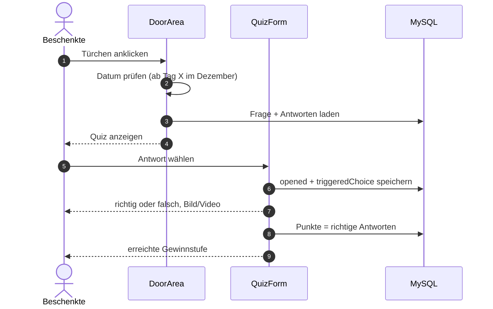
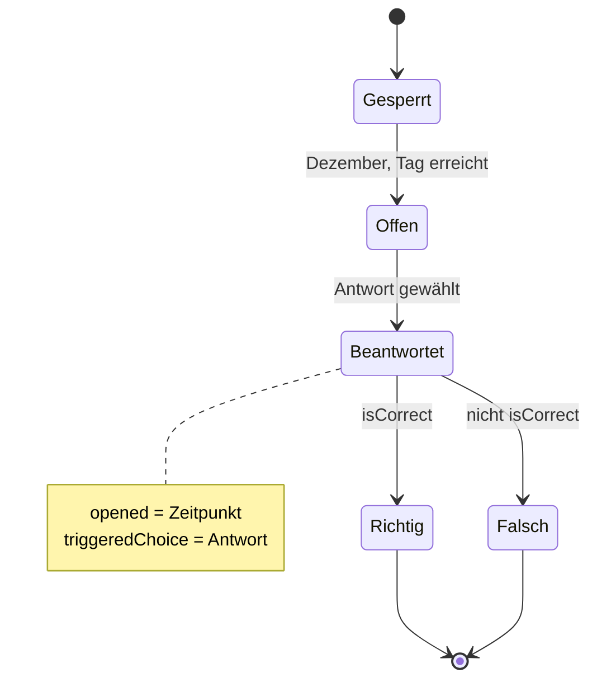
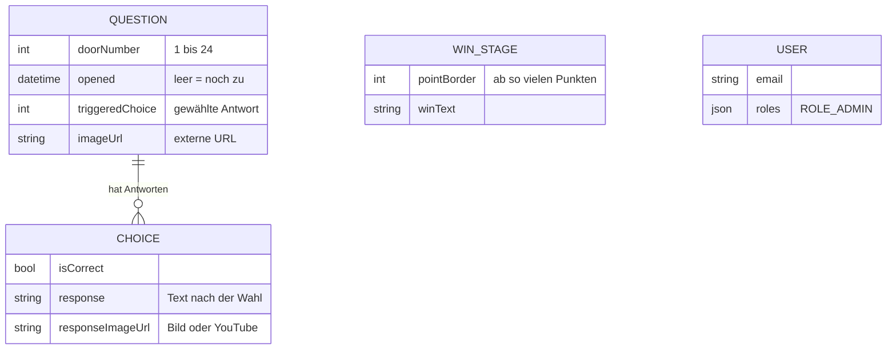
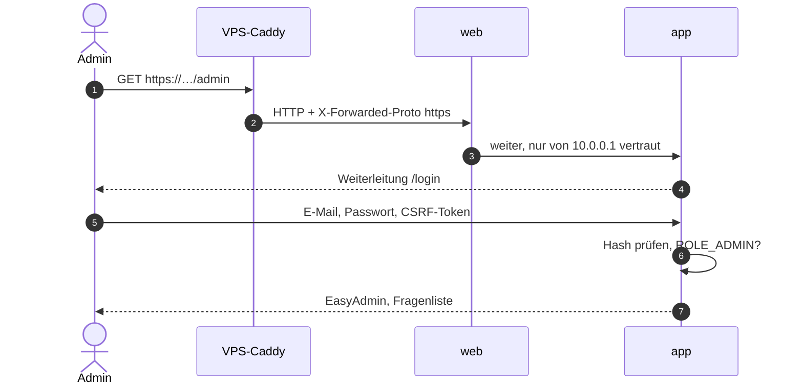
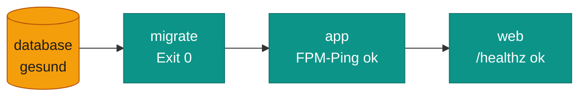

# Aufbau

Ein Symfony-8-Projekt, zwei Anwendungen:

| | Kresh-Journey | Adventskalender |
|---|---|---|
| Adresse | `/` (Testvariante `/testing`) | `/devtest`, `/demo` (Route `/` ist auskommentiert) |
| Zustand | **live** | **ruht**, beide Routen liefern zurzeit 500 |
| Inhalt kommt aus | Code: `src/Service/SlideProvider.php` | Datenbank: Tabellen `question`, `choice`, `win_stage` |
| Technik | Twig + Vanilla-JS, Tailwind per CDN | Symfony UX Live Components (`DoorArea`, `QuizForm`) |
| Speichert etwas? | nein, Fortschritt nur im Browser | ja: wann ein Türchen geöffnet wurde und welche Antwort gewählt wurde |

## Die Journey

Eine lange Seite, deren Folien man nacheinander herunterscrollt. Neun Folien sind **gesperrt**: Das Scrollen hält
an, bis das Spiel darauf gelöst ist. Vier Spiele fragen dafür den Server, die übrigen prüfen im Browser.

<ol>
<li data-title="Öffnen" data-where="Browser" data-icon="phone" data-label="GET /">

Die Startseite wird einmal komplett gerendert: alle 20 Folien, Rätseldaten aus dem <code>SlideProvider</code>. Die Datenbank wird dafür nicht gefragt.

</li>
<li data-title="Scrollen" data-where="Browser" data-icon="browser" data-label="gesperrt">

Normale Folien erzählen die Geschichte. Kommt eine Folie mit <code>data-locked</code>, sperrt das Skript das Weiterscrollen.

</li>
<li data-title="Spielen" data-where="Browser" data-icon="gear" data-label="POST /api/…">

Terminal, Sauna, Kennzeichen und Kniffel schicken die Eingabe an <code>/api/run-code</code>, <code>/api/sauna-choice</code>, <code>/api/kennzeichen-check</code> bzw. <code>/api/kniffel-roll</code>. Quiz, Food-Game, Taste-Tinder und Rubbellos laufen nur im Browser.

</li>
<li data-title="Antwort" data-where="App" data-icon="box" data-label="success">

Der <code>JourneyController</code> vergleicht mit der festen Lösung und antwortet mit JSON (<code>success</code> + Text). Er speichert nichts.

</li>
<li data-title="Weiter" data-where="Browser" data-icon="check">

Bei Erfolg wird die Folie entsperrt, und es geht weiter. Ein Neuladen setzt alles zurück.

</li>
</ol>

*Die Journey ist zustandslos: Der Server prüft nur Antworten, der Fortschritt lebt im Browser.*

## Der Adventskalender (ruht)

Ein Türchen öffnet sich ab seinem Dezembertag. Nach dem Öffnen kommt eine Quizfrage mit mehreren Antworten, und
die gewählte Antwort wird gespeichert. Richtige Antworten ergeben Punkte, und die Punkte schalten Gewinnstufen frei.

*Beide Komponenten sind Live Components: Jeder Klick ist ein kleiner Request, und der Server rendert den Teil neu.*

- **Modi:** `USER_MODE` (normal, speichert), `DEMO_MODE` (zeigt nur schon geöffnete Türchen, damit niemand vorab die
  Lösungen sieht) und `DEV_MODE` (alle Türchen offen, speichert nichts).
- **Fragen nachladen:** `php bin/console app:update-door <nr>` liest `data/question/<nr>.json` und ersetzt damit die
  Frage, aber nur, solange das Türchen noch nicht geöffnet ist.
- **Startdatum** steht fest im Code (`DoorArea::isDoorUnlocked`). Ausgewertet werden aber nur Monat und Tag, das Jahr
  spielt keine Rolle.

!!! warning "Warum er gerade nicht läuft"
    Die Route `/` gehört jetzt der Journey. `/devtest` und `/demo` brechen mit 500 ab, und `QuizForm` ruft Methoden
    auf, die `Choice` nicht hat. Details unter [Probleme](probleme.md#bekannte-fehler-in-der-app).

## Lebenszyklus eines Türchens

*Es gibt kein eigenes Statusfeld. Der Zustand ergibt sich aus dem Datum und den Spalten `opened` und `triggeredChoice`.*

## Datenmodell

*Nur `question` und `choice` hängen zusammen. `win_stage` wird über die Punktzahl zugeordnet, `user` dient nur dem
Admin-Login. Die Journey nutzt keine dieser Tabellen.*

Beim Umzug übernommen wurden 24 Fragen, 77 Antworten und 5 Gewinnstufen (siehe [Daten](daten.md#herkunft-der-daten)).

## Admin-Login

*Symfony muss die Anfrage als HTTPS erkennen, sonst scheitert das CSRF-Token. Dafür sorgt die Kette
`REVERSE_PROXY_IPS` → `TRUSTED_PROXIES`.*

- Sitzungen liegen im Container. Nach jedem Deploy ist man abgemeldet, und das ist so gewollt.
- `/register` gibt es noch, die Route ist aber kaputt (500). Konten entstehen nur per Konsole.

## Startreihenfolge im Stack

*Jeder Dienst wartet auf den vorherigen. `web` gilt erst als gesund, wenn `/healthz` über PHP bis zur Datenbank
durchkommt.*
