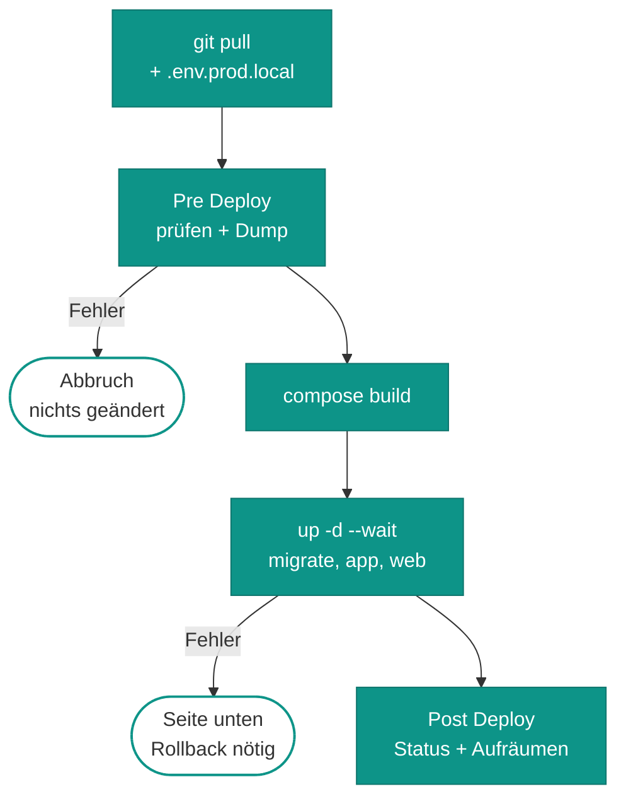

# Betrieb

Deployt wird **von Hand in Komodo**: Webhook, Polling und Auto-Update sind aus. Den Stack `advent` und die Procedure
`advent-backup` beschreibt [deploy/komodo/advent.toml](https://github.com/rextuus/advent/blob/main/deploy/komodo/advent.toml);
ein Resource Sync gleicht sie an.

## Deploy

<div class="hl-steps" markdown>

1. **Lokal fertig machen**
   Bei Änderungen an Entities `make migration` ausführen, die Migration prüfen und committen. Danach `git push` auf `main`.
2. **Komodo → Stack `advent` → Deploy**
   Komodo holt den Code per `git pull` und schreibt `.env.prod.local` mit den eingesetzten Secrets.
3. **Pre Deploy prüft und sichert**
   Fehlt eine Variable, passen Projektname und `VOLUME_PREFIX` nicht zusammen oder scheitert der Dump, bricht der Deploy hier ab, ohne etwas zu ändern.
4. **Build und Start**
   Die Images werden gebaut, dann folgt `up -d --wait`: `migrate` → `app` → `web`. Der Deploy ist erst grün, wenn alles gesund ist.
5. **Post Deploy lesen**
   Im Log erwartet: `Webserver: {"status":"ok","database":"ok"}` und eine `[OK]`-Zeile der Migrationen. Alte Advent-Images werden aufgeräumt.
6. **Smoke-Test**
   Startseite öffnen und bis zum ersten Spiel scrollen, dann `/admin` aufrufen und einmal anmelden.

</div>



*Was in Komodo bei einem Deploy passiert. Ein Fehler im Pre Deploy ist harmlos. Scheitert dagegen `up`, ist der alte
Container schon ersetzt.*

!!! warning "Kein `--remove-orphans`"
    Komodo ruft `up -d` ohne `--remove-orphans` auf. Ein Dienst, den man aus `compose.prod.yaml` entfernt oder
    umbenennt, läuft weiter, bis man ihn von Hand stoppt.

## Rollback

<div class="hl-steps" markdown>

1. **Guten Commit eintragen**
   Komodo → Stack `advent` → Feld *Commit*: den Hash des letzten funktionierenden Stands eintragen.
2. **Deploy**
   Wie oben. Der Pre Deploy legt dabei noch einmal einen Dump an.
3. **Datenbank zurück, falls nötig**
   Migrationen laufen nur vorwärts. Hat die fehlerhafte Version das Schema geändert, den passenden `…-pre-deploy.sql.gz` einspielen ([Wiederherstellen](daten.md#wiederherstellen)).
4. **Feld wieder leeren**
   *Commit* leeren, damit der nächste Deploy wieder den neuesten Stand nimmt. Ein Resource Sync setzt das Feld ohnehin zurück.

</div>

## Dienste und Jobs

| Dienst | Image | Läuft | Aufgabe |
|---|---|---|---|
| `web` | `advent-web:prod` (Caddy 2.11) | dauerhaft | HTTP auf `10.0.0.2:7999`, liefert `public/` aus, reicht PHP weiter, Healthcheck `/healthz` |
| `app` | `advent-app:prod` (PHP 8.5 FPM) | dauerhaft | die Symfony-App, Healthcheck per FPM-Ping |
| `database` | `mysql:8.4.11` | dauerhaft | Daten im Volume `advent_prod_mysql_data` |
| `migrate` | `advent-app:prod` | einmal je Deploy | `doctrine:migrations:migrate`, danach beendet |
| `backup` | `mysql:8.4.11` | auf Abruf (Profil) | Dump mit Rotation nach `/srv/advent/backups` |

| Job | Wann | Wer |
|---|---|---|
| Datenbank-Dump `daily` | täglich 01:30 (Europe/Berlin) | Komodo-Procedure `advent-backup` |
| Datenbank-Dump `pre-deploy` | vor jedem Deploy | `deploy/komodo/pre-deploy.sh` |
| Aufräumen alter Images | nach jedem Deploy | `deploy/komodo/post-deploy.sh` |

In Komodo stehen `migrate` und `backup` unter *Ignore Services*. Sonst würde der Stack wegen der beendeten Container
als „Unhealthy“ gelten.

## Variablen

Komodo schreibt sie bei jedem Deploy nach `/etc/komodo/stacks/advent/.env.prod.local`. Ändern also nur in Komodo,
nie in der Datei. Die Vorlage mit Erklärungen ist
[.env.prod.dist](https://github.com/rextuus/advent/blob/main/.env.prod.dist).

| Name | Zweck | Secret |
|---|---|---|
| `APP_SECRET` | Symfony-Schlüssel für Sitzungen und CSRF (Komodo: `ADVENT_APP_SECRET`) | ja |
| `MYSQL_PASSWORD` | Passwort des DB-Benutzers `app` (Komodo: `ADVENT_MYSQL_PASSWORD`) | ja |
| `MYSQL_ROOT_PASSWORD` | Root-Passwort, auch für die Dumps (Komodo: `ADVENT_MYSQL_ROOT_PASSWORD`) | ja |
| `SENTRY_DSN` | Fehlermeldungen an Sentry, optional (Komodo: `ADVENT_SENTRY_DSN`) | ja |
| `DEFAULT_URI` | öffentliche Adresse für Links aus der Konsole | nein |
| `MYSQL_DATABASE`, `MYSQL_USER` | Name von Datenbank und Benutzer, gehören fest zum Volume | nein |
| `HTTP_BIND`, `HTTP_PORT` | einziger Host-Port: WireGuard-IP von abyss und 7999 | nein |
| `REVERSE_PROXY_IPS` | nur dieser Absender (VPS) darf `X-Forwarded-*` setzen | nein |
| `BACKUP_DIR`, `BACKUP_KEEP` | Zielordner der Dumps, Anzahl je Anlass (14) | nein |
| `USER_PASSWORD` | nur für Fixtures und `app:update-door`, im Betrieb nicht gesetzt | ja |
| `VOLUME_PREFIX` | nur für Probeläufe, auf dem Server **nie** setzen | nein |

!!! danger "DB-Passwörter nie ändern"
    MySQL übernimmt die Passwörter beim allerersten Start ins Volume. Wer sie danach in Komodo ändert, sperrt die
    App aus (`/healthz` → 503). Die Werte liegen im Passwortmanager.

## Konsole

| Befehl | Wofür |
|---|---|
| `app:user:set-password <mail> --create --admin` | Admin-Konto anlegen oder Passwort neu setzen (fragt verdeckt, mindestens 12 Zeichen) |
| `app:update-door <1–24>` | Kalender: Frage eines noch geschlossenen Türchens aus `data/question/<nr>.json` neu laden |
| `doctrine:migrations:status` | Stand der Migrationen |

=== "Komodo"

    Stack `advent` → Container `app` → *Terminal*, dann `php bin/console <befehl>`.

=== "Auf abyss"

    ```bash
    sudo docker exec -it advent-app-1 php bin/console <befehl>
    ```

=== "Notweg mit make"

    ```bash
    cd /etc/komodo/stacks/advent
    sudo make prod-status      # Container, /healthz, letzte Sicherung
    sudo make prod-backup      # Dump, Anlass „manuell“
    sudo make prod-up          # Sicherung + Build + Start wie Komodo, ohne Post Deploy
    ```

## Lokal entwickeln

`compose.yaml` startet `php`, `caddy` (auf `http://127.0.0.1:7999`) und `database` (MySQL 8.4.11, wie in
Produktion). Die Dev-Daten liegen im eigenen Volume `advent_mysql_data`.

```bash
make up                 # bauen und starten
make db                 # Migrationen, spielt auch die Altdaten ein
make console CMD="app:user:set-password <mail> --create --admin"
make assets             # Webpack Encore
```

- In der lokalen `.env` muss `DATABASE_URL` auf `database:3306` zeigen.
- `npm install` braucht `install-links=true` aus `.npmrc`, sonst scheitert es an den `file:`-Paketen aus `vendor/`.
- Für eine **Generalprobe des Produktions-Stacks** immer eigenen Projektnamen und eigenes `VOLUME_PREFIX` nehmen.
  `pre-deploy.sh` erzwingt das. Anleitung in
  [docs/deployment.md](https://github.com/rextuus/advent/blob/main/docs/deployment.md#generalprobe-auf-dem-eigenen-rechner).
