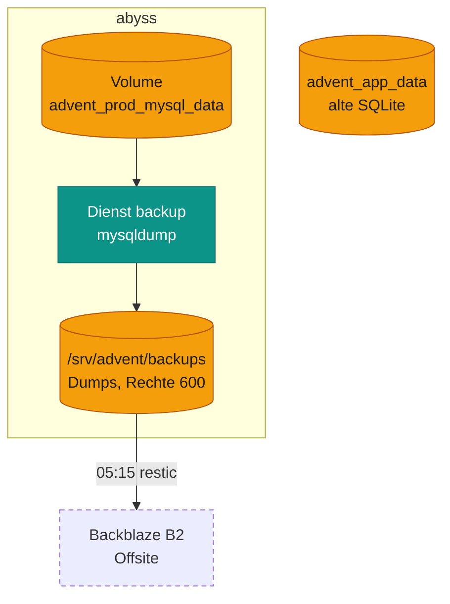
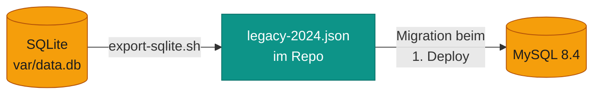

# Daten

Advent hat genau eine Datenquelle: **MySQL** im Volume `advent_prod_mysql_data`. Uploads gibt es nicht. Alle Bilder
und Videos sind externe URLs, und die Journey speichert nichts auf dem Server.

*Die Datenbank wird lokal gedumpt, und die nächtliche Offsite-Sicherung von abyss nimmt den Ordner mit. Das alte
SQLite-Volume ist ein Überbleibsel des Umzugs.*

| Was | Wo | Gesichert |
|---|---|---|
| Fragen, Antworten, Gewinnstufen, Admin-Konto, Migrationsstand | Volume `advent_prod_mysql_data` (Name fest, unabhängig vom Projektnamen) | ja, als Dump |
| Dumps | `/srv/advent/backups` auf abyss (Ordner 700, Besitzer root) | ja, offsite |
| Code, Journey-Inhalte, Rätsellösungen | Git (`rextuus/advent`), im Stack-Ordner `/etc/komodo/stacks/advent` | über GitHub |
| Sitzungen, Cache | im Container | nein, nach jedem Deploy weg |
| Altdaten von 2024 (SQLite) | Volume `advent_app_data`, `/opt/advent` | nein |

!!! note "Annahme: Altlasten noch vorhanden"
    Laut Umzugsplan sollten `advent_app_data`, `/opt/advent` und `/srv/advent/umzug` nach ein paar ruhigen Tagen
    gelöscht werden. Das ist vermutlich **noch nicht** passiert. Prüfen mit
    `docker volume ls --filter name=advent_app_data`. Erst löschen, wenn mindestens ein `daily`-Dump existiert.

## Sicherung

| Anlass | Wann | Datei | Bleiben liegen |
|---|---|---|---|
| `daily` | täglich 01:30, Procedure `advent-backup` | `advent-db-<UTC-Zeit>-daily.sql.gz` | 14 |
| `pre-deploy` | vor jedem Deploy | `advent-db-<UTC-Zeit>-pre-deploy.sql.gz` | 14 |
| `manuell` | Procedure *Run* oder `sudo make prod-backup` | `advent-db-<UTC-Zeit>-manuell.sql.gz` | 14 |

- Rotiert wird **je Anlass getrennt**. Viele Deploys verdrängen also keine täglichen Dumps.
- Ein Dump wird erst unter seinem Namen abgelegt, wenn er vollständig ist (Abschlusszeile, `CREATE TABLE`, `gzip -t`).
  Halbe Dateien bleiben nie liegen.
- Läuft der Stack nicht, **scheitert der tägliche Dump absichtlich**, und Komodo schickt einen Alarm.
- 01:30 liegt vor dem Neustart von abyss (04:30) und vor der Offsite-Sicherung (05:15).

## Wiederherstellen

1. **Dump auswählen**
   `sudo ls -1 /srv/advent/backups`. Nach einem misslungenen Deploy ist das der neueste `…-pre-deploy.sql.gz`.
2. **Schreiber stoppen**
   `cd /etc/komodo/stacks/advent`, dann `sudo docker compose -p advent -f compose.prod.yaml --env-file .env.prod.local stop app web`.
3. **Einspielen**
   Mit demselben Compose-Aufruf: `run --rm --no-deps -T --entrypoint sh backup -c 'gunzip -c /backups/<datei> | mysql -h database -u root'`.
   Der Dump ersetzt alle Tabellen und bringt auch den Stand der Migrationen mit.
4. **Wieder starten**
   `up -d --wait` oder in Komodo *Deploy*.
5. **Prüfen**
   `/healthz` liefert `ok`, `/admin` zeigt die Fragen, die Startseite lädt.

Die Zugangsdaten des DB-Benutzers stecken nicht im Dump, sondern im Volume. Ein Dump passt deshalb nur zu den
Passwörtern, die in Komodo hinterlegt sind.

### Aus der Offsite-Sicherung

1. **Dump aus B2 holen**
   Wie auf der Homelab-Seite zur Offsite-Sicherung beschrieben (restic, Pfad `/srv/advent/backups`).
2. **Nach `/srv/advent/backups` legen**
   Rechte 600, Besitzer root.
3. **Einspielen**
   Weiter wie oben ab Schritt 2.

## Herkunft der Daten

Bis November 2026 lief Advent von Hand aus `/opt/advent` mit SQLite. Beim ersten Komodo-Deploy hat die Migration
`Version20261111120000` den Inhalt aus `migrations/data/legacy-2024.json` (24 Fragen, 77 Antworten,
5 Gewinnstufen, **ohne** Konten) in die leere MySQL-Datenbank geschrieben. In einer Datenbank mit Daten tut sie
nichts. Das Admin-Konto wurde danach neu angelegt.

*Der Umzug war einmalig. Die JSON-Datei bleibt im Repo, damit eine frische Datenbank (lokal oder nach „nochmal von
vorn“) dieselben Inhalte bekommt.*

Das vollständige Umzugsprotokoll mit Rückfallebene steht in
[docs/deployment.md](https://github.com/rextuus/advent/blob/main/docs/deployment.md#umzug-und-erster-deploy-einmalig).
