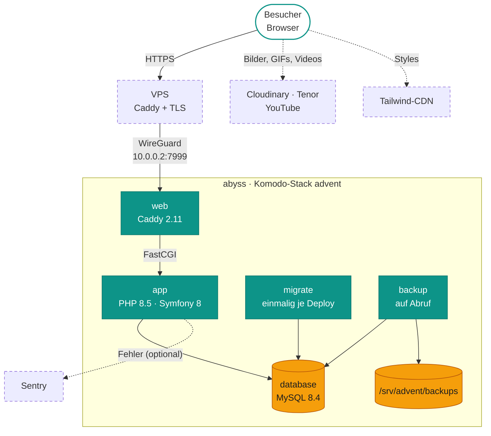

# Advent – Kresh-Journey

Ein Geschenk zum <em>Durchscrollen</em> – mit <em>Rätseln</em> statt Geschenkpapier.

Eine persönliche Geburtstagsgeschichte für genau eine Beschenkte: 20 bildschirmfüllende Kapitel über ein gemeinsames Jahr. Neun davon geben den Weg erst frei, wenn das Mini-Spiel gelöst ist.

<ol>
<li data-title="Geschichte zum Scrollen" data-icon="image" data-badges="20 Kapitel|Vollbild-Fotos|ohne Konto">

Kapitel für Kapitel durch ein gemeinsames Jahr scrollen. Hinter jedem liegt ein großes Foto, das beim Weiterscrollen sanft überblendet.

</li>
<li data-title="Rätsel als Türsteher" data-icon="lock" data-badges="9 Spiele|Scroll-Sperre|Nochmal-Knopf">

An neun Stellen hält die Geschichte an, und weiter geht's erst nach dem Spiel. Wer festhängt, versucht es nochmal oder überspringt (bei den meisten Spielen).

</li>
<li data-title="Wischen, Gießen, Rubbeln" data-icon="sparkle" data-badges="Swipe-Karten|Button halten|Rubbellos">

Top-oder-Flop-Karten wischen wie in einer Dating-App, Soße durch Gedrückthalten genau dosieren und ein Rubbellos freirubbeln, dazu Konfetti.

</li>
<li data-title="Kniffel am Tisch" data-icon="star" data-badges="5 Würfel|3 Würfe|Kniffel-Punkte">

Würfel halten, neu werfen, und nach dem dritten Wurf die beste Kategorie wählen, vom Einer bis zum Kniffel.

</li>
<li data-title="Quiz &amp; Kennzeichen" data-icon="search" data-badges="10 Fragen|7 Kennzeichen|Punktestand">

Ein Pop-Kultur-Quiz und eine Kennzeichen-Jagd quer durch Deutschland. Wie gut kennt man die Beschenkte wirklich?

</li>
<li data-title="Persönlicher Einlass" data-icon="users" data-badges="5 Rollen|eigene Antwort">

Zu Beginn fragt die Seite, wer da schaut. Familie, Freunde und Kollegen bekommen jeweils ihre eigene Begrüßung.

</li>
</ol>
<ul class="hl-showcase__tags"><li>Terminal-Rätsel</li><li>Sauna-Timing</li><li>Hollandaise-Gießen</li><li>Taste-Match</li><li>Konfetti</li><li>Milchglas-Karten</li><li>Fotos überblenden</li><li>Fürs Handy gebaut</li><li>Fortschritt bleibt im Browser</li><li>Neuladen = Neustart</li><li>Adventskalender (ruht)</li><li>24 Quiz-Türchen</li></ul>

Eine kleine Symfony-App mit zwei Gesichtern: Auf der Startseite läuft die **Kresh-Journey**, eine scrollbare
Geschichte mit eingebauten Mini-Spielen (ein persönliches Geschenk). Daneben steckt im selben Code der
**Adventskalender** von 2024 mit 24 Quiz-Türchen und Admin-Oberfläche. Er **ruht** zurzeit und ist nicht erreichbar.

  
<b>3</b>Dienste dauerhaft web, app, database

  
<b>2</b>Dienste auf Abruf migrate, backup

  
<b>4</b>Tabellen Doctrine-Entities

  
<b>13</b>eigene Routen davon 4 Spiel-APIs

  
<b>20</b>Folien der Journey davon 9 Mini-Spiele

  
<b>24</b>Türchen Adventskalender (ruht)

  
<b>3</b>Routen mit Fehler 500 /register, /devtest, /demo

-   :material-gift-outline:{ .lg } **Für wen**

    ---

    Eine einzelne Beschenkte: Die Journey ist ein persönliches Geburtstagsgeschenk, der Kalender war ein
    Adventsgeschenk. Kein Massenpublikum, keine Konten für Besucher.

-   :material-gamepad-variant-outline:{ .lg } **Was es kann**

    ---

    **Journey:** siehe Showcase oben. **Kalender (ruht):** ein Türchen pro Dezembertag, Quizfrage, Punkte und
    Gewinnstufen.

-   :material-shield-lock-outline:{ .lg } **Wer was darf**

    ---

    Die Journey ist öffentlich, ohne Login. Nur `/admin` (EasyAdmin: Fragen, Antworten, Gewinnstufen) braucht ein
    Konto mit `ROLE_ADMIN`. Das Konto wird per Konsole angelegt, siehe [Betrieb](betrieb.md#konsole).

## Architektur

*Der Besucher erreicht über den VPS und WireGuard den Caddy des Stacks. PHP spricht nur mit MySQL. Bilder und Videos
liegen nicht auf abyss: Der Browser lädt sie direkt von Cloudinary, Tenor und YouTube.*

- **Nach außen** gibt es nur einen Port: `web` lauscht auf `10.0.0.2:7999`, und nur der VPS kommt dorthin.
- **Gespeichert** wird nur in MySQL. Uploads gibt es keine, und die Journey merkt sich nichts auf dem Server: Wer
  neu lädt, fängt von vorne an.
- **Hintergrunddienste** und Mails gibt es keine. Der einzige zeitgesteuerte Job ist die tägliche Sicherung um
  01:30 (Komodo-Procedure `advent-backup`).

## Weiterlesen

| Seite | Inhalt |
|---|---|
| [Aufbau](aufbau.md) | Journey und Kalender als Ablauf, Datenmodell, Lebenszyklus eines Türchens |
| [Betrieb](betrieb.md) | Deploy, Rollback, Dienste, Variablen, Konsole, lokal entwickeln |
| [Daten](daten.md) | Volume, Sicherungen, Offsite, Wiederherstellung |
| [Probleme](probleme.md) | Symptom → Ursache → Abhilfe |

Die ausführliche Betriebsanleitung im Repo, mit allen Befehlen und dem Protokoll des Umzugs von SQLite auf MySQL:
[docs/deployment.md](https://github.com/rextuus/advent/blob/main/docs/deployment.md).
