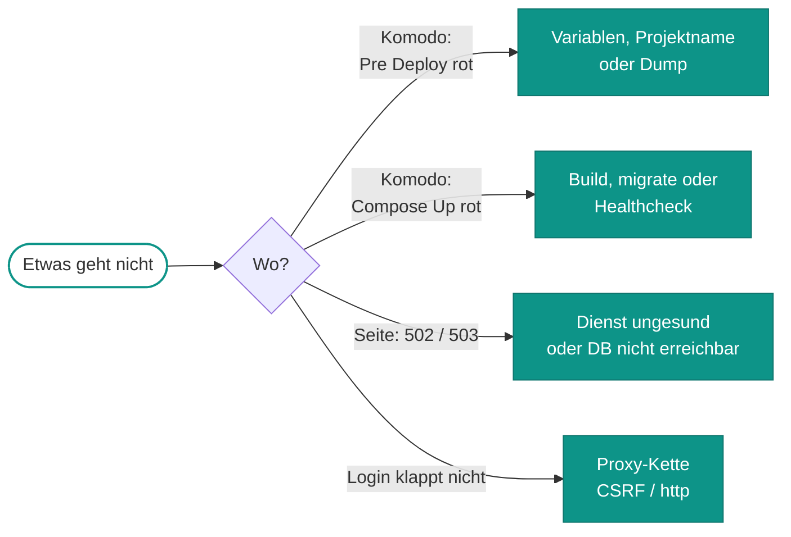

# Probleme

Zuerst klären, **wo** es rot ist:

*Ein roter Pre Deploy hat nichts verändert. Ein rotes Compose Up kann die Seite schon mitgenommen haben.*

Für die meisten Fälle hilft erst einmal: Komodo → Stack `advent` → *Updates* (Deploy-Log) bzw. Service → *Log*.

## Deploy

??? failure "Pre Deploy: „In Komodo fehlen diese Variablen/Secrets“"
    **Ursache:** Komodo lässt einen unbekannten `[[NAME]]`-Verweis wörtlich stehen, und das Skript fängt das ab.

    **Abhilfe:** Unter Settings → Variables den genannten Namen anlegen (Schreibweise beachten, Häkchen *Secret*).
    Ohne Sentry die Zeile `SENTRY_DSN = …` aus dem Stack-Environment löschen, statt eine leere Variable anzulegen.

??? failure "Pre Deploy: „VOLUME_PREFIX ist gesetzt …“ oder „Projekt … ohne VOLUME_PREFIX …“"
    **Ursache:** Schutz gegen Probeläufe auf echten Daten. Projektname und `VOLUME_PREFIX` passen nicht zusammen.

    **Abhilfe:** In Produktion gilt *Project Name* `advent`, und `VOLUME_PREFIX` darf im Environment **nicht** stehen.

??? failure "„bind source path does not exist: /srv/advent/backups“"
    **Ursache:** Der Sicherungsordner fehlt. Docker legt ihn absichtlich nicht selbst an.

    **Abhilfe:** `sudo install -d -m 700 /srv/advent/backups`, oder `BACKUP_DIR` auf Tippfehler prüfen.

??? failure "„Bind for 10.0.0.2:7999 failed: port is already allocated“"
    **Ursache:** Ein anderer Container hält den Port, oft ein Waise aus einer früheren Compose-Datei (Komodo entfernt
    keine Waisen).

    **Abhilfe:** `docker ps --filter publish=7999` zeigt den Container. Ihn stoppen und erneut deployen.

??? failure "Compose Up rot, `migrate` beendet mit Fehler"
    **Ursache:** Eine Migration ist gescheitert. `app` ist dann schon ersetzt, startet aber nicht, **die Seite ist unten**.

    **Abhilfe:** Stack → Service `migrate` → Log lesen. Danach den Fehler beheben und neu deployen oder
    [zurückrollen](betrieb.md#rollback). MySQL nimmt Tabellenänderungen nicht zurück, deshalb im Zweifel den
    Pre-Deploy-Dump einspielen.

??? failure "Clone oder Pull rot"
    **Ursache:** Das Token des Komodo-Git-Accounts `rextuus` darf das private Repo nicht lesen.

    **Abhilfe:** Im GitHub-Token unter *Repository access* `rextuus/advent` mit „Contents: Read-only“ freigeben.

## Laufzeit

??? failure "`/healthz` → 503 `degraded`"
    **Ursache:** PHP läuft, erreicht aber die Datenbank nicht. Meist ist die DB nicht gesund, oder die
    Passwort-Variablen passen nicht zum Volume.

    **Abhilfe:** `docker logs advent-database-1` lesen und die DB-Secrets in Komodo mit dem Passwortmanager vergleichen.
    Nie neue Passwörter würfeln.

??? failure "Login: „Invalid CSRF token“ oder Weiterleitung auf `http://`"
    **Ursache:** Symfony erkennt die Anfrage nicht als HTTPS, weil die Proxy-Kette nicht stimmt.

    **Abhilfe:** `REVERSE_PROXY_IPS` muss die WireGuard-IP des VPS sein (`10.0.0.1`), und der VPS-Caddy muss per
    `reverse_proxy` weiterleiten. Test:
    `docker exec advent-web-1 wget -qS -O /dev/null http://127.0.0.1/admin 2>&1 | grep -i location`.

??? failure "Stack „Unhealthy“, obwohl die Seite läuft"
    **Ursache:** Die beendeten Container `migrate` und `backup` werden mitgezählt.

    **Abhilfe:** *Ignore Services* im Stack muss `migrate` und `backup` enthalten (kommt aus `advent.toml`).

??? failure "Nach einem Deploy in `/admin` abgemeldet"
    **Ursache:** Die Sitzungen liegen im Container und gehen beim Neubau verloren. Das ist so gewollt, kein Fehler.

    **Abhilfe:** Neu anmelden. Passwort vergessen? `app:user:set-password <mail>`, siehe [Konsole](betrieb.md#konsole).

## Sicherung

??? failure "Procedure `advent-backup` schlägt fehl"
    **Ursache:** Meist läuft der Stack nicht („Unknown MySQL server host 'database'“). Der Dump startet absichtlich
    keine Datenbank nebenbei. Seltener fehlt das Secret `ADVENT_MYSQL_ROOT_PASSWORD`.

    **Abhilfe:** Stack starten bzw. das Secret anlegen, danach die Procedure von Hand mit *Run* starten und in
    `/srv/advent/backups` nachsehen.

## Bekannte Fehler in der App

Diese Fehler haben nichts mit dem Betrieb zu tun. Sie betreffen nur den ruhenden Adventskalender und die
Registrierung. Die Journey ist davon nicht berührt.

??? bug "`/register` → 500"
    **Ursache:** `RegistrationFormType` übergibt dem `IsTrue`-Constraint ein Options-Array, und das unterstützt
    Symfony 8 nicht mehr.

    **Abhilfe:** Wird nicht gebraucht, Konten entstehen per Konsole. Beheben erst, wenn die Registrierung wieder gewollt ist.

??? bug "`/devtest` und `/demo` → 500"
    **Ursache:** `templates/components/QuizForm.html.twig` verweist auf die Route `app_calendar`, und die ist in
    `CalendarController` auskommentiert.

    **Abhilfe:** Vor dem nächsten Dezember entweder die Route wieder einhängen oder den Verweis ändern.

??? bug "Kalender-Quiz: fehlende Methoden an `Choice`"
    **Ursache:** `QuizForm` ruft `getTextCorrect()`, `getTextIncorrect()` und `getUrlIncorrect()` auf, und die gibt
    es in `Choice` nicht (mehr). Spätestens nach einer Antwort bricht die Anzeige ab.

    **Abhilfe:** Vor einer Reaktivierung des Kalenders auf `getResponse()` bzw. `getResponseImageUrl()` umstellen.
